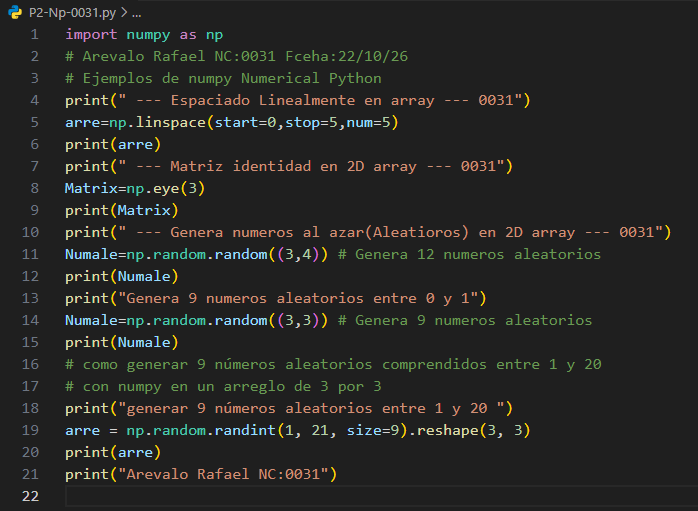
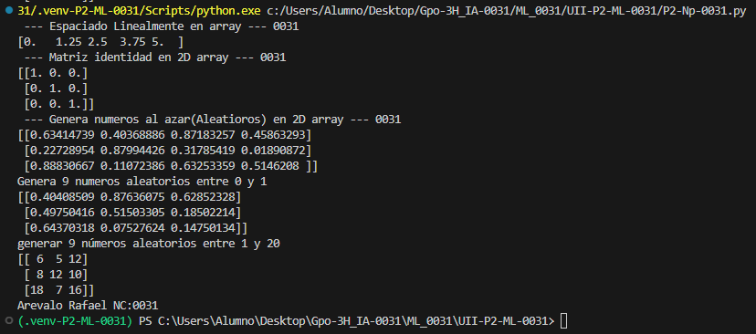

- `start=0`: Indica el valor inicial de la secuencia.
- `stop=1`: Indica el valor final (no se incluye).
- `num=5`: Indica la cantidad de números que se generarán.

## Como es np.linspace 
linspace es una función de NumPy que genera una cantidad determinada de números distribuidos uniformemente entre un valor inicial y uno final.

## El codigo

## Resultados

